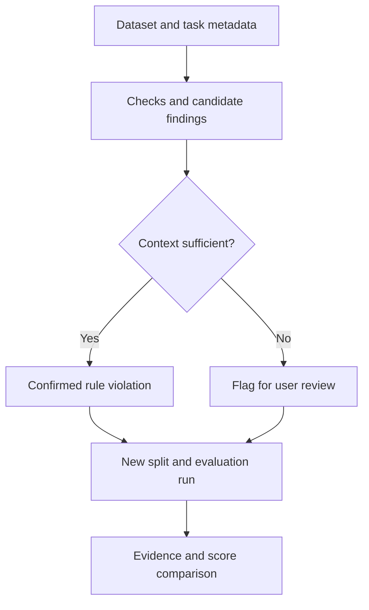

# Synopsis — Dataset Crime Scene

**Ishdeep Singh · 12 November 2026**

## V2 interface release

A forensic data table.

- Search raw and displayed rounded values; paginate the sample table
- Finding selection highlights implicated columns or real duplicate rows
- Task, entity, time and feature-availability configuration
- Original/corrected evaluation comparison and CSV import

Only supplied task metadata can establish prediction-time feature availability. Audit heuristics cannot certify every possible leak. The underlying domain scope and research-extension boundaries below remain explicit.

## Implemented release

Runnable source: `lab/dataset.py`. Interface and backend are included. Tests and benchmark outputs accompany this distribution.

## Limits of the implemented release

Tabular classification audits using explicit task metadata. No guarantee of detecting every kind of leakage.

## Measured evaluation

```json
{
  "original": {
    "accuracy": 1.0,
    "macro_f1": 1.0,
    "train_rows": 495,
    "test_rows": 165,
    "features": [
      "subject",
      "age",
      "signal",
      "post_event_result",
      "day"
    ]
  },
  "corrected": {
    "accuracy": 0.43636363636363634,
    "macro_f1": 0.43561734524991724,
    "train_rows": 495,
    "test_rows": 165,
    "features": [
      "age",
      "signal"
    ]
  },
  "strategy": "grouped new-entity holdout",
  "excluded": [
    "post_event_result"
  ],
  "note": "Different split protocols answer different generalization questions. Only explicitly unavailable features are excluded as leaks; correlations remain review findings."
}
```

## Original specification and proposed extensions

The material below preserves the design ambitions. Future-tense features and anticipated challenges are not completed-development claims.

Dataset Crime Scene

**Tagline:** Ninety-nine percent accuracy? Interesting. Show me the split.

### Concept, problem, and users

Dataset Crime Scene inspects datasets and modelling workflows for reasons an evaluation might be misleading. Duplicate rows, entity overlap, future information, and preprocessing on the whole dataset can inflate scores. The system produces evidence-backed findings and compares the original evaluation with an appropriate corrected protocol.

Target users are students, data scientists, and reviewers checking ML results. Its contribution is a benchmarkable defect-detection workflow, with separate treatment of confirmed violations and suspicious patterns that need context.

### Proposed product and workflow

Upload a tabular dataset, identify the target and prediction moment, and provide entity/time metadata where available. The tool profiles data, proposes checks, presents findings, and previews a split strategy. Users review a target-proxy warning before the system excludes a feature. Corrected evaluation creates a new run; it must never silently rewrite the original result.

Screens: upload and task setup, column profile, relationship findings, duplicate clusters, split preview, before/after evaluation, and report. Every finding includes affected records or columns, evidence, severity, and a suggested verification step.

### Data and system design

Records: `DatasetVersion`, `TaskDefinition`, `ColumnAvailability`, `EntityGroup`, `SplitManifest`, `Finding`, and `EvaluationRun`. Prediction-time feature availability is explicit metadata. A strong correlation is not itself proof of leakage.

Generate corrupted variants from clean controls: exact duplicates, near duplicates, cross-split entities, future-derived features, target copies, noisy labels, and whole-dataset preprocessing. Retain an injection manifest inaccessible to the detector. Hold out corruption recipes and original dataset families for evaluation.

### Algorithms and experiments

Baseline: hashes, overlap checks, and configurable metadata rules. Add similarity methods for near duplicates, adversarial train/test classification for distribution differences, and out-of-fold label-quality indicators. Distribution separability indicates a difference to investigate; it does not prove a leak.

Use pipelines that fit preprocessing within each training fold; scikit-learn's common-pitfalls documentation explains this leakage issue [R8]. Correction choices may require group-aware or chronological splits rather than a random split. For time tasks, apply a gap where delayed features or overlapping windows require it.



Metrics: precision and recall by defect type, false alerts on clean datasets, runtime, memory use, and the score change under corrected evaluation. A lowered score can be a useful finding, not a failure of the tool. Ablate availability metadata and near-duplicate search. Evaluate the report's evidence quality separately from defect detection.

### Anticipated problems, in my voice

| What could go wrong | My likely reaction | Engineering response |
|---|---|---|
| Every predictive feature gets accused | “The detector thinks competence is suspicious.” | Ask whether the feature exists at prediction time |
| Approximate matching groups unrelated records | “These two people share a postcode, not an identity.” | Configurable similarity and reviewable evidence |
| Corrected accuracy looks worse | “The model did not get dumber. The exam stopped leaking.” | Explain changed evaluation conditions and retain both runs |

### Demo, milestones, and limits

Show a high-scoring dataset, reveal cross-split duplicates, choose a grouped split, and compare the corrected score. Milestones: CSV task setup; exact checks; corruption benchmark; split repair; near duplicates; pipeline-aware audit. Deliver a findings report and reproducible evaluations. Code-availability checks and domain metadata are needed before claiming broad pipeline understanding. No tool can certify that an arbitrary dataset is free of every possible leak.


## Problems actually encountered during the makeover

| The problem | In my voice | What changed |
|---|---|---|
| Sample B overwrote the file used by sample A | “Bro, this is an A/B test, why did B steal A’s identity?” | Recordings now get unique file names; a regression test checks both files remain distinct and unchanged. |
| A duplicate highlight followed row positions instead of duplicate evidence | “Apparently every third row had been arrested on vibes.” | Duplicate highlights now use exact record content and jump to a real duplicate. |
| The table displayed a rounded number that search did not match | “I copied the number from your own screen, my guy.” | Search checks both raw values and the formatted values visible in the table. |
| Graph labels became tiny on a phone | “Causal inference, now available to ants.” | Graph workspaces keep readable node widths and scroll within their own viewport. |
| Robot movement and the play button disagreed about whether it was running | “Gordon left the parking spot while the button was still contemplating life.” | The live flag is synchronized after accepted commands and remains off after rejected commands. |
| Fast screenshots caught an interface between renders | “The UI took a smoke break precisely when the camera arrived.” | Captures were inspected, incomplete frames replaced, and videos labelled as edited screenshots. |

These are observed build issues. Proposed research challenges in the original specifications remain proposed; this log does not invent months of model training or real deployments.
